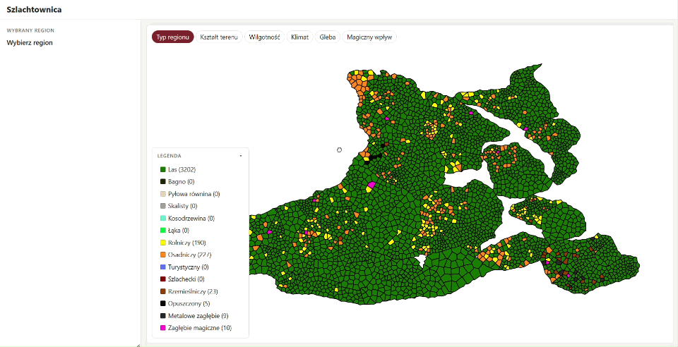

# Szlachtownica – frontend

Frontend w Angularze 17 do projektu [Szlachtownica](https://github.com/mfurmane/szlachtownica2). Projekt jest w trakcie rozwoju.

## Co robi

- Pobiera z backendu geometrie prowincji i regionów (GeoJSON) i rysuje je jako interaktywną mapę SVG.
- Regiony można kolorować według jednej z sześciu cech: typu regionu, ukształtowania terenu, wilgotności, klimatu, gleby lub wpływu magii. Legenda na mapie pokazuje, ile regionów należy do każdej kategorii, a kliknięcie kategorii podświetla jej regiony.
- Po najechaniu na region dymek pokazuje jego prowincję i wartość bieżącej cechy, a w niektórych trybach także dodatkowe dane, np. żyzność gleby.
- Kliknięty region pulsuje na mapie, a panel boczny pokazuje jego szczegóły. Kliknięcie wartości cechy w panelu przełącza mapę na tę cechę i podświetla regiony o tej samej wartości.
- Mapę można przybliżać kółkiem myszy i przesuwać przeciąganiem.



Komponenty są standalone i korzystają z nowej składni szablonów (`@if`, `@for`, `@switch`) oraz sygnałowych inputów. Wspólny stan (zaznaczenie, region pod kursorem, tryb kolorowania, dane mapy) trzymają serwisy oparte na RxJS.

## Uruchomienie

Wymagany jest działający [backend](https://github.com/mfurmane/szlachtownica2) (Spring Boot, PostgreSQL + Hibernate Spatial) pod adresem `http://localhost:8080`.

```bash
npm install
npm start
```

Aplikacja będzie dostępna pod `http://localhost:4200/`.
